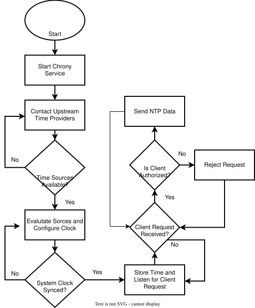

# Conceptual Design
## Introduction
Precise, accurate, and secure timing is critical for many applications, from banking networks to national security, however, in certain cases, the individual, such as a hobbyist, may also require such timing systems for their own needs. Our project shall create and demonstrate a framework in which an individual may have their own precise, secure, and available timing system.   

Unsecured time servers are vulnerable to a multitude of issues, including spoofing, man-in-the-middle attacks, connection loss, as well as unavailability due to power loss and other factors.  Additionally, being reliant upon only one source for time exacerbates these concerns. A failure or attack on any of these elements could create a cascade of issues.  

This project aims to provide a solution to this issue, via a more secure and robust, GPS-based, NTP server that may be replicated by the individual. We aim to use GPS as the primary time source, with secondary sources acting to corroborate and confirm the GPS. These include other GNSS systems, such as Galileo or BeiDou, radio broadcasts, oscillators, and internet sources. We shall provide a multilayered defense, including NTP and authentication, as well as comparing and contrasting our various sources, and fail-safes for signal or power loss.   

Off-the-shelf solutions, while available, do not provide the same functionality relative to our expected cost, often featuring less robust servers or being prohibitively expensive. Additionally, due to our design being intended to be disseminated to the public, there will theoretically exist space within the project for the individual to make changes, and add or remove elements as they need. 

  
## Fully Formulated Problem
The Primary objective of this project is to build a low cost, accessible, and effective Network Timer Server that provides accurate timestamps by using time references like satellite constellations and online servers. The system shall also be secure from attempts of subversion such as DDOS and Man in the Middle attacks.

The system shall be able to be constructed easily and inexpensively for use by the general public. In doing so, individuals and organizations will have access to extraordinarily accurate and secure time to ensure proper operation of their systems.

## Comparative Analysis of Potential Solutions
The biggest consideration within this project was deciding our solution for NTP communication; our two proposed solutions were to either use a SoC running Linux with an open-source solution such as Chrony or some microcontroller with bare-metal implementation. There are advantages and disadvantages for each approach:

|       | SoC Implementation                                                                                                                                                                                                                   | Microcontroller Implementation                                                                   |
| ----- | ------------------------------------------------------------------------------------------------------------------------------------------------------------------------------------------------------------------------------------ | ------------------------------------------------------------------------------------------------ |
| Pros: | - Ease of implementation - Built-in NTS and other security protocols - Simple Multiple Time Source integration - Easy time source metric tracking, such as drift of individual sources - Simpler Networking capabilities | - Lower Cost - More Compact                                                                   |
| Cons: | -May increase the total cost of the project                                                                                                                                                                                          | - Harder overall implementation - Requires more time to develop -  Potentially less secure |
Given the options proposed, we decided that the marginally lower cost wasn't worth the difficulties involving implementation and potential security issues of a bare-metal solution. With the advantages that an SoC provides, it's the clear choice for this project.

Once we decided our system type, the next item of consideration was our time sources. Our client specifications required a GPS source, so that made it non-negotiable. The additional sources (Radio, Oscillator, and Internet Time Servers) we consider adding are to improve the robustness of the system.

## High-Level Solution
The Network Time Server provides a secure platform that will allow its users to retrieve accurate timestamps which will allow them to properly operate their systems. By integrating accurate time sources, precise and reliable hold-over systems, protection from malicious entities, and flexible, capable open source software,the design will achieve accurate timestamps even in hostile enviorments.

### Power Supply
The power supplies' job is to provide power to maintain a stable operating condition in normal and in extraordinary conditions, have a back supply incase the wall outlet fails. It should be able to switch fast enough as to maintain synchronicity after loss of power. 

### GNSS Module
The GNSS Module is the main source of timestamps of the system. It should be able provide accurate timestamps even in nonideal conditions such as cloudy skies, or bad atmospheric conditions. It will also be able to detect spoofing and jamming attempts

### Processor
This is the brains of the system. It coordinates the operation of the GNSS Module, external oscillator, and transmission of timestamps to clients. It will be able to change the settings of the system to the user's desired settings. It will also coordinate security and quality checks.

### Client Communication
The client communication is the bridge between the server and the clients. It ensures proper distribution of timestamps to clients, and ensures the clients have proper authentication.

### Device Security
This encompasses the overall security of the system. The system will have a firewall to prevent unwanted intrusions and ensure proper authentication to access the secure timestamps and to change the settings of the system.

### Holdover Oscillator
In normal conditions, the system will receive timing from the satellite constellations, however, sometimes this synchronization will be lost. The oscillator will be continuously tuned with the incoming signal to ensure timestamps will continue to be accurate.

### Enclosure
The enclosure is the body that will contain the entire system. It will provide proper cooling, and protection from external attacks. It will also provide ease of access for authenticated users.

### Hardware Block Diagram

Note that the radio clock module in this diagram is an optional component. 
### Operational Flow Chart

  The NTP server is designed to operate autonomously after the initial admin configuration. During normal operation the server receives data from upstream time sources and uses them to discipline its own system clock. Upon request from a client the server will relay its system time to allow the client to sync its own clock with the NTP server. Both the Clock Synchronization and Client Communication subsystems loop repeatedly, both of which are outlined above. Users will primarily be interacting with the server during the initial install and subsequent maintenance and troubleshooting. The operational flowchart showcases the normal operating behavior of the server.

## Subsystems

## GNSS Module

The GNSS Module is the main source for retrieveing the timestamps that our system will be distributing downstream. First, it recieves a signal containing the 
timestamp from a satellite constallation. Second, it will run a check to attempt to detect spoofing, and it will then log ephemermis imformation if power is lost
or a hot start is attempted. Lastly it will transmitt the timestamp to the main processing unit for further use.

Functions:
- Recieve Timestamps
- Perform Security Checks

Inputs:
- Timestamps from satellites
- Programming from processor using USB
- Power from power supply

Outputs:
- Timestamp sent to processor using I2C/UART
- Current Status sent to processor using I2C/UART

Interfaces:
- Settings Control from processor 
- Data echange with processor
- Power from power supply

High-Level Requirements:
- Shall Retrieve accurate timestamps
- Shall be secure from attempts to spoof or attack it

## Processor

The processor is responsible for orchestration of the entire system. Its primary duties are recieving timestamps from the GNSS module and checking the stamp's integrity.
Run an open source software called Chrony, which is an extremely powerful software that allows for rigorous security, and flexible distrobution of the timestamps
to clients downstream. It will also tune an oscillator to timestamps recieved, which is needed if the system loses synchronization to the time sources.
The SoC will also be used to program external modules like the GNSS module to achieve the desired settings the user wants. Lastly, the SoC will transmit
the secure timestamps to clients, and will display its current settings and status to the user.

Functions:
- Recieve and process timestamps
- Tune the holdover system
- Enforce rigorous security measures
- Transmit timestamps to clients

Inputs:
- Commands to change system settings
- Timestamps from GNSS via UART/I2C
- Status from peripherials
- Power from Power Supply

Outputs:
- Timestamps to clients over wifi or ethernet cable.
- Commands to peripherials over I2C/UART
- Current status and settings

Interfaces:
- Information from external modules (GNSS, Oscillator)
- Transmission of timestamps to clients
- Power from power supply

High-Level Requirements:
- The system shall recieve accurate timestamps from satellite constellations
- The system will ensure the timestamps are secure and that the system is resistant from attempts to subvert it
- The system will be able properly control peripherials and transmitt accurate timestamps to clients

## Client Communication  
Client communication is the system that uses the hyper-accurate system time determined by the Clock Synchronization subsystem and relays that to the clients in need of NTP data. The client will request NTS credentials to be able to verify its identity in the future. This is called the Transport Layer Security (TLS) handshake. The client and server register each other as trusted communicators and create credentials called cookies that are used in future communications [1]. When the client needs NTP data it sends a request to the server using its cookies, the server receives processes and sends back the accurate time data. Using the time given by the server the client will adjust its internal clock to match the server, taking into account any delay accrued from the transmission. [2]  

Functions: 
- Supply accurate NTP data to the clients on its network  
- Maintain high levels of security using NTS to ensure the accuracy of the data  

Inputs:  
- Clock disciplined system time determined by the clock synchronization system.   

Outputs:  
- NTP signals, secured by NTS, carrying the data to clients

High-Level Requirements:
- The system shall relay secure NTS protected signals  
- The system shall relay accurate information to connected clients

## Device Security  
Device security encapsulates the measures needed to protect the server from cybersecurity threats beyond incorrect timing data. It will allow the device to be safe from bad actors on its network. To ensure a secure server, we will implement a firewall to lock down the ports and allow only the ones needed for basic server function. This includes port 123 for NTP, port 4460 for NTS and port 22 for SSH (A secure network protocol used to remotely access systems)[1][2]. To allow for secure administrator control SSH key authentication will be implemented to prevent potentially faulty passwords that can be compromised[4]. We will restrict Chrony to a non-root user to ensure that if Chrony is compromised, the attacker cannot gain access to the entire server[3]. Monitoring will also be used to ensure important configuration files are secure and unchanged and noting any NTP synchronization anomalies[3].  

Functions:  
- Protect the NTP server from unauthorized access and attempted compromise.
- Safely monitor the NTP server to allow for secure admin access.
- Log suspicious activity for administrator review.

Inputs: 
- Incoming internet communication and signals of any kind
- Information from connected physical devices such as USB interfaces

Outputs: 
- Security-authorized inputs to be passed onto the Clock Synchronization subsystem

High-Level Requirements:
- The system shall remain secure and protected from intentional interference using firewalls and software quarantining. 
- The system shall block all incoming signals except those needed for device functionaility. 
- The system shall provide secure access for administrators using SSH.

### The Holdover Oscillator   
The Oscillator provides a consistent periodic signal as a time reference for the system to use when all other methods fail, or to use between periods of incoming reference signals for a more accurate device output. Depending on the type of oscillator used, if it is not an enclosed unit, we may need to implement a control loop to output a signal suitable for the SoC. 

Functions:
- Providing a known time reference signal
Inputs:
- Power from power supply
Outputs:
- A known reference frequency sent to the SoC
High-Level Requirements:
- The system shall keep a holdover with at most a 1 s/day drift
- The system shall maintain a consistent and predictable pulse frequency

## Clock Synchronization

The system will receive various signals and, using the data received, output one unified time signal.  GPS will be ordinarily taken as standard, and thus used as the primary time source.  However, if GPS signal is lost, or falls outside of acceptable tolerance, then other sources will be brought to the foreground. [B]  The first to be used after GPS fails will be the alternate GNSS constellations, such as Galileo or BeiDou.  Should those also fail, the internet sources, such as NIST, will be taken.  Finally, the WWVB Radio signal will be taken.  [A]   All of these will be compared against the oscillator's holdover system, which, in the event of total signal loss, will act as the last clock source remaining.  
The output will be the time code received of the most reliable signal. 

Should a jump in real-time output occur, the output will be slewed into accuracy.  Slewing is the process by which a clock, rather than skipping ahead in time, alters its speed to gradually match the correct time.

The reliability check will work as such: each received signal will be taken, with an expected tolerance (transmission/propagation delay, jitter, etc), and compared against each other and the oscillator, weighted in terms of priority.  If a signal is an outlier, it will be momentarily flagged until it comes back into agreement. 

Purpose:
- Validate the accuracy of received time signals and determine output signal.

Input:
- Internet Sources
- Oscillator and PPS
- GPS + GNSS
- WWVB Radio

Output:
- Accurate time signal upon client request

High Level
- The system shall receive multiple signal inputs.
- The system shall validate the received inputs and disregard those declared invalid.
- The system shall output a valid time signal. 

## Enclosure

The enclosure subsystem pertains to the elements physically holding the entire project together. 

The specific dimensions of the outer shell will be determined at a later date when exact hardware is chosen. It will provide physical protection to the systems inside from tampering and physical damage. Mounts will be used to hold the components securely inside of the enclosure. These will ensure that the pieces remain where they are intended to be. Depending on the overall wattage and temperature produced, a cooling device may be needed to maintain a certain internal temperature, so that the hardware's function will not be affected. An internal fan will likely be used for this purpose.  

Additionally, ports are to be included so that the power supply and any other exterior components may interface with the internal components.

Finally, our electrical systems need to be connected with wiring to facilitate the needed communication between systems.

Purpose:
- House the electrical and internal components securely.

High Level:
- The system shall regulate the design's temperature.
- The system shall maintain the device's integrity.

## Ethical, Professional, and Standards Considerations

This project will expand on the security and accuracy of currently available timing systems, which is a crucial part of PTN (positioning, timing, navigation). Timing, due to its broad use and necessity in critical systems, has a great need for improvements to security. This project will aim to provide these needed improvements for an affordable cost.

Additionally, the design and dissemination of this project will contribute to greater time server independence, meaning that this project will likely provide timing more precise and resilient than standard, default internet based timing, while also no longer being so overly reliant on the internet. Finally, the project will be released publicly, thus reducing the barriers for any who may be interested in following this design. This improves accessibility and inclusivity of the project.

Risk to Network Security
This project will involve network connections from various sources, including international sources. These, along with communications between the server and the client, leave the potential open for malicious activity. 
Mitigation: We plan to make the signal communications secure via systems like NTS, and quarantine the signals to only what they are needed for, thus keeping any malicious activity reasonably contained.

False sense of security
This project, as it is designed for improving the security of time servers, may give the user an overconfidence in this design, such that they may imagine hat they will have no risk of tampering or failure. This is not the case, even the completed design will not be immune to all issues, and theoretically a sufficiently skilled malicious actor could still disrupt the design. 
Mitigation: In order to solve this issue, we intend to have clear documentation on each part of the project, clearly specifying exactly what capabilities the design possesses, so that there may be no confusion or estimation as to what the project may do.

Environmental Impacts
This project may impact the environment due to waste products, especially if the design is imprecise or cumbersome to follow. 
Mitigation: We plan to mitigate this issue by having precise documentation, thus allowing any who come after us to create this design without wasting or destroying any components.

Cost and Skill to implement
This project, despite its reduced cost compared to the current market, may still be prohibitively expensive for those creating it, or too challenging to implement.
Mitigation: While there is only so much that may be done for the cost of this project, we intend to reduce necessary costs as much as reasonably possible, thus making the design as accessible as can be helped. Additionally, we may mitigate the skill requirement by being precise and explanatory in our design documents so that the skill requirements may be as low as reasonably possible.

Ethics:
While this project is designed for the individual to have a secure time server, this does not come without ethical considerations. First of all, we as engineers must clearly communicate to both our client and any who come after us that this project will not be a perfectly secure system, as none is. Additionally, our project will employ a number of open source software, as well as off-the-shelf components, and thus will be vulnerable to any issues inherent to them. We must therefore keep expectations clear and precise regarding the exact elements of this project. Honesty, integrity, transparency, and safety must be core pillars of our design process. The engineers involved must hold themselves to the IEEE Code of Ethics. 15

Ethics in Design Decisions:
Additionally, teams must consider relevant standards organizations that will inform the design process. A comprehensive discussion should be included on how these considerations have influenced the design. This includes detailing constraints, specifications, and practices implemented as a result, and how these address the identified considerations. 

These prior ethical considerations have influenced our design decisions in the following ways:

In keeping with our ethical commitments to clarity and functionality, the project shall adhere to the following technical standards and specifications:
	NISTTN2187 
	ANSI C63.10 Compliance Testing of Unlicensed Wireless Devices 
	Title 47 CFR Part 15 regulation for Radio Frequency Devices 
	RFC 5905 Network Time Protocol Version 4 

Also, our decision to use off-the-shelf components and software, rather than designing the entire system from the ground up, was for the sake of ease of use and implementation, so as to not unduly burden those with smaller budgets or limited skillsets.

Finally, our design features many network security features so that malicious activity may be limited and restrained, insofar as reason and our available technology permits. These include a firewall and interface monitoring.  Additionally, our own software will not contain malicious elements. 

## Resources

You have already estimated the resources needed to complete the solution. Now, let's refine those estimates.

## Budget
### SoC
| Item         | Description                              | Quanity | Cost (Estimate) |
|--------------|------------------------------------------|---------|-----------------|
| Computer     | A small computer to run the Linux server | 1       | $100            |
| 32Gb SD Card | Small resiliant storage                  | 1       | $30             |
|              |                                          | Total:  | $130            |    

The computer will be the core unit of the system and  should be chosen for its combination of cost and performance, as well as it's ability to run the computations necessary. The 32Gb micro SD card will be chosen as a trustworthy storage medium and its ability to hold the required software and operating system. 

### GNSS + Radio
| Item         | Description                              | Quanity | Cost (Estimate) |
|--------------|------------------------------------------|---------|-----------------|
| GNSS Satelite Antenna/Reciever | The antenna and reciever for the GPS system                    | 1      | $300  |
| PPS Wire                       | A wire for the PPS singal to connect to a I/O port on the SOC  | 1      | $5    |
| AM Radio Reciever (Optional)             | The antenna and reciever for the 60kHz WWVB  radio time source | 1      | $15   |
|                                |                                                                | Total: | $320  |  

The GNSS portion of this project is a major factor in what makes this system resiliant. The GNSS receiver needs to be capable of receiving signals from multiple constelations as well as being accruate enough to allow for our desired system accuracy of ()us. To ensure both of these criteria are met, a more robust GNSS module is needed. The seperate PPS wire will allow for the PPS signal to reach a I/O port on the SoC, increasing accuracy. In addition to GNSS signal our server will recieve radio signal from the WWVB NTP frequency. This adds an additional input source that is not connected to any other, improving the resiliancy of our system.  

### Enclosure
| Item         | Description                              | Quanity | Cost (Estimate) |
|--------------|------------------------------------------|---------|-----------------|
| Enclosure   | Enclosure to store all components in a way that is neat and orderly    | 1      | $100  |
| Mounting    | Mounting for the SOC and other ports                                   | 1      | $30   |
| Cooling     | Possible internal fans and cooling methods                             | 1      | $30   |
| misc wiring | The remaining physical connectors we may need (Ethernet, Jumper, etc.) | 5      | $30   |
|             |                                                                        | Total: | $190  |  

The enclosure subsystem contains the parts holding the entire project together. We will determine the size of the enclosure based on the specific parts that will be chosen in the future. It will provide physical protection to the systems inside. Mounting will be used to hold the components inside of the enclosure. They are what ensures the peices remain where they are intended to be. Depending on the overall wattage and tempterature produced, some kind of cooling may be needed to maintain desired internal temperature. A small fan will likely be used to acheive this. Finally, our systems need to be connected with wiring to allow the needed communication between systems. The misc wiring  was added to cover for the connections we will need. 

### Power + Holdover
| Item         | Description                              | Quanity | Cost (Estimate) |
|--------------|------------------------------------------|---------|-----------------|
| External Oscillator | A device to keep highly accurate system time                     | 1      | $150 |
| Battery Bank        | Allows the devices to keep running in the case of a power outage | 1      | $100 |
| SOC AC Adapter      | Cables to power the SOC                                          | 1      | $20  |
|                     |                                                                  | Total: | $270 |  

Holdover is the systems ability to remain accurate for a duration of time without activly receiving input from the various sources. A strong holdover time allows our system to be a trusted source regardless of what external circumstances are affecting the inputs. A powerful external oscillator will allow this to happen. To allow for the desired accuracy of ()us we need a well tested and trusted oscillator. In addition to the loss of input signal, it is possible for the system to lose power for a duration of time. To remedy this we will encorporate a power bank/UPS to allow for the server to continue running without power for a set time, ensuring our time server remains accurate regardless of outages. The SoC AC adapter will allow for our selected SoC to receive direct power.

Develop a budget proposal with justifications for expenses associated with each subsystem. Note that the total of this budget proposal can also serve as a specification for each subsystem. After creating the budgets for individual subsystems, merge them to create a comprehensive budget for the entire solution.

### Division of Labor

First, conduct a thorough analysis of the skills currently available within the team, and then compare these skills to the specific requirements of each subsystem. Based on this analysis, appoint a team member to take the specifications for each subsystem and generate a corresponding solution (i.e. detailed design). If there are more team members than subsystems, consider further subdividing the solutions into smaller tasks or components, thereby allowing each team member the opportunity to design a subsystem.

### Timeline

## References
All sources utilized in the conceptual design that are not considered common knowledge must be properly cited. Multiple references should be included.

clock synch
a) https://chrony-project.org/faq.html#_an_unreachable_source_is_selected
b) https://chrony-project.org/faq.html#_how_should_chronyd_be_configured_with_gpsd

## Statement of Contributions
Block Diagram - Jonathan Salvato
Comparative Analysis - Jonathan Salvato
Timeline - Jocelyn Lee
Power System - Jocelyn Lee
Introduction - Everett Patterson
Holdover Oscillator - Jonathan Salvato
Clock Synchronization - Everett Patterson
Ethics - Everett Patterson
Enclosure - Everett Patterson 
GNSS - Merric Anderson
SoC - Merric Anderson
High Level Solution- Merric Anderson
State the Problem- Merric Anderson
