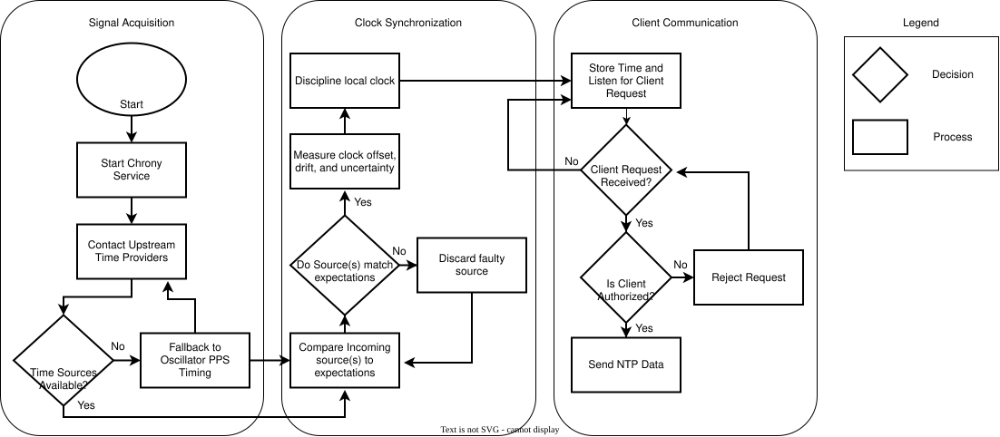

# Midterm Design Document
## Introduction
Precise, accurate, and secure timing is critical for many applications, from banking networks to national security, however, in certain cases, the individual, such as a hobbyist, may also require such timing systems for their own needs. Our project shall create and demonstrate a framework in which an individual may have their own precise, secure, and available timing system.   

Unsecured time servers are vulnerable to a multitude of issues, including spoofing, man-in-the-middle attacks, connection loss, as well as unavailability due to power loss and other factors.  Additionally, being reliant upon only one source for time exacerbates these concerns. A failure or attack on any of these elements could create a cascade of issues.  

This project aims to provide a solution to this issue, via a more secure and robust, GPS-based, NTP server that may be replicated by the individual. We aim to use GPS as the primary time source, with secondary sources acting to corroborate and confirm the GPS. These include other GNSS systems, such as Galileo or BeiDou, radio broadcasts, oscillators, and internet sources. We shall provide a multilayered defense, including NTP and authentication, as well as comparing and contrasting our various sources, and fail-safes for signal or power loss.   

Off-the-shelf solutions, while available, do not provide the same functionality relative to our expected cost, often featuring less robust servers or being prohibitively expensive. Additionally, due to our design being intended to be disseminated to the public, there will theoretically exist space within the project for the individual to make changes, and add or remove elements as they need. 

#### Stakeholder
This project was created at the request of our primary stakeholder, Dr. Jeffrey Austen, who requested a resilient GPS-disciplined time source using NTP.  He requested this time source to be resilient particularly against GPS signal loss, while maintaining accuracy and precision over time.  Additionally, he requested that this design be accessible to those with limited budgets and resources.  

This has affected several design choices, such as the prioritization of GPS or the use of Chrony software to handle NTP, as well as our commitment to using as easily accessible parts and procedures as reasonably possible.

## Fully Formulated Problem
The Primary objective of this project is to build a low cost, accessible, and effective Network Timer Server that provides accurate timestamps by using time references like satellite constellations and online servers. The system shall also be secure from attempts of subversion such as DDOS and Man in the Middle attacks.

The system shall be able to be constructed easily and inexpensively for use by the general public. In doing so, individuals and organizations will have access to extraordinarily accurate and secure time to ensure proper operation of their systems.

### Background
Secure and accurate timing is paramount in most modern systems in a multitude of industries. 
Examples include power generation, where plants need accurate time to log errors and 
synchronize generators, the finance industry needs accurate timestamps to track transactions to 
prevent theft and fraud, and modern navigation systems, like GPS, needs precise timing so that it 
can track a position accurately, otherwise the target will drift off course[^1]. As the dependence on 
more accurate time increases, the need for more reliable time distribution has become 
increasingly important.

Network Timer Servers (NTS) solve this by obtaining accurate time from trusted sources such as:
satellite constellations and local atomic clocks. Then, it is distributed downstream 
to clients via the Network Time Protocol[^2]. In a typical system, the server receives a reference 
time, disciplines a local oscillator to maintain reference time, and distributes that time to clients.

While this system is effective and efficient at distributing time, it has several security 
vulnerabilities. The system is reliant on external time sources, which can be interrupted and 
subverted by an attacker. Attacks such as spoofing, where an attacker can disguise themselves as 
a time signal, and jamming, where signals are interrupted, can cause the server to lose its 
synchronization with the correct time. Since many systems rely on having access to this absolute 
time for logging, authentication, and decision-making, a compromised time source can have 
consequences that can cause immense damage.

Therefore, creating a secure and resilient time source is of extraordinary importance to the 
functioning of society. It must be secure from attempts from malicious entities to subvert the system, and from damage 
from outside sources to ensure functioning even in extreme and hostile situations.

### Specifications and Constraints
#### Specifications
The GPS regulated Secure Network Time Server will:
1. Keep and Broadcast the current time:
	-The server shall keep time within an accuracy of at most 100 us to UTC with an internal holdover of  at most 40 us/day
	-The server shall obtain the time from multiple sources including:
		-GNSS sources such as GPS
		-An Internal Oscillator
		-Network sources such as NIST Internet time servers
	-The server may, if time allows:
		- Obtain time from radio time such as WWVB
		- Output a reference clock signal from the oscillator
	-The server shall communicate the current time data through the NTPv4 standard
2. Maintain Security:
	-The server shall maintain a secure connection to clients connected through NTS
	-The server shall be resilient to external attacks, such as:
		-GPS Spoofing or Jamming
		-DOS/DDOS attacks
		-The loss of any one time source
		-Power Loss
3. Be open source and accessible to a hobbyist:
	-The server's design and details shall be published to the public
	-The server shall have components that are accessible and build instructions that are able to be followed by someone with little to moderate electronics knowledge
	-The server's cost needs to be minimized 
	-The server's Licenses for software must be compatible and open source
#### Constraints
The GPS Regulated Secure Network Time Server will adhere to:
1. Server Standards and regulations
	-The server shall be compliant with the RFC 5905 Network Time Protocol Version 4
	
	-The server shall follow the guidelines set by the NISTTN2187 for resilient architecture
	
2. Wireless Receiver and device Standards and regulations
	-The server shall be compliant with the ANSI C63.10 Compliance Testing of Unlicensed Wireless Devices
	
	-The server shall be compliant with the Title 47 CFR Part 15 regulation for Radio Frequency Devices

We, the design team, will adhere to the IEEE Code of Ethics, as seen from Section 7 - Professional Activities of the IEEE Policies

## Survey of Existing Solutions
Many GPS governed NTP servers already exist on the market today. Many of these solutions, however, are for an industrial scale which makes them bulky, incredibly high in cost, and generally inaccessible.

For example, Masterclock's GMR1000 is an enterprise-grade time server that can synchronize to GPS, NTP, and PTP sources (among others). It contains a high-stability oscillator which gives it a strong holdover of a 5us drift per day[^3] It's a great time server, but costs ~$1595.00[^4], which makes it inadequate for hobbyist use.

For another example of an industrial server, Microchip’s SyncServer S600. Similarly, this is a high security and high accuracy NTP/PTP time server. It has an optional atomic clock, enabling a holdover drift of <1 us per day. The standard drift without the atomic clock is around 400 us per day[^5]. This NTP server hovers around $5000-11000[^6][^7] making this an extreme example of high cost.

Of course, there are more accessible options on the market, but most of these come with tradeoffs of precision, security, or relative cost.

For a lower cost, Time Machines Corp. has a fleet of NTP time servers[^8]: The TM1000A ($349.99)[^8], TM2000B ($549.99)[^8], TM2500C ($799.99)[^8], and TM3000A ($999.99)[^8]. All of these are capable of GPS synchronization and support NTPv4. However, only the TM3000A is capable of security protocols such as NTS. Additionally, the TM1000A lacks a holdover time source and none have more than one backup time source[^9]. While these servers will work, they're either expensive or lacking in security features.

Compiling the servers options above:

| NTP Server           | GMR1000                                | SyncServer S600                                                   | TM1000A           | TM2000B               | TM2500C               | TM3000A               |
| -------------------- | -------------------------------------- | ----------------------------------------------------------------- | ----------------- | --------------------- | --------------------- | --------------------- |
| Cost                 | $1595.00                               | $5000-11000                                                       | $349.99           | $549.99               | $799.99               | $999.99               |
| Time Sources         | GNSS, OCXO Oscillator                  | GNSS, Rubidium atomic clock or OCXO                               | US GPS Satellites | GNSS, OCXO Oscillator | GNSS, OCXO Oscillator | GNSS, OCXO Oscillator |
| Security Features    | Monitoring, SSH SHA2 AES256 encryption | Security Hardening, GPS Jamming and Spoofing Detection/protection | None              | NTS, https, SNMPv3    | NTS, https, SNMPv3    | NTS, https, SNMPv3    |
| Holdover Time Source | 5μsec / day                            | <1μsec / day or 400 μsec / day                                    | N/A               | ~43μsec / day*        | ~43μsec / day*        | ~43μsec / day*        |

*Time Machines Corp doesn't include the TM3000A in their Accuracy Paper[^16], but it can be assumed it's the same oscillator as the TM2000B and TM2500C.

As can be seen, there is no shortage in available time server solutions, however many of these solutions are expensive and/or lacking in available security or timekeeping measures. With this project we hope to offer a solution with a low cost, secure, and accurate time server. 

## Measures of Success

The success of this project will be based on the time source's ability to provide reliable time in hostile and normal conditions. The following Key Performance Indicators (KPIs) will be used to determine whether the system meets the technical, timing, and security requirements.

***1. Timing and Synchronization Accuracy***

Objective: Verify that the system can maintain accurate time reference using external sources while delivering it to clients.

Methodology:

- Reference accuracy: Compare the system's output to a trusted time source to confirm correctness.
- Synchronization accuracy: Compare the system's oscillator to the time sources over a period.
- Timing Stability: Observe the error of the system to identify drift or other variations.
- Longterm stability: Operate the system over a period of time to determine whether the system can maintain synchronicity.
- Time Verification: Determine whether clients downstream are receiving the correct time, and is stable.

***2. GPS Reliability***

Objective: Verify whether the system can reliably acquire signals and accurately acquire timestamps.

Methodology:

- Initial Acquisition: Measure the time it takes for the module to acquire a signal from a cold start.
- Signal Strength: Measure the performance of the system under varying signal strengths and antenna conditions.
- Satellite Availability: Test the system over a variation in satellite number, and evaluate the minimum conditions for accurate acquisition.
- Tracking: Determine whether the system can maintain a lock with synchronization.
- Restart Testing: Test whether the system can cycle power and acquire a signal and gain synchronization.
- Antenna Testing: Determine whether the antenna and cabling can provide a quality signal over a period of time.

***3. Holdover Performance***

Objective: Verify the signal can provide accurate timestamps without a time source

Methodology:

- Time Source Interruption: Intentionally interrupt the signal and measure the timing error as the system transitions to using the internal oscillator.
- Duration: Determine how long the system can maintain accurate timestamps without a time reference.
- Oscillator Stability: Determine oscillator drift and its effect on time accuracy.
- Recovery Testing: Provide a valid time reference and measure whether the synchronization is correct quickly so not to produce time discontinuation.
- Repeated Time Source Interruption: Repeatedly disconnect and reconnect a signal and verify consistency.

***4. Network Time Distribution***

Objective: Verify that a externally disciplined time source can accurately distribute timestamps to clients.

Methodology:

- NTP Synchronization: Connect multiple clients and verify that each client receives the correct timestamps.
- Network Testing: Test synchronization under varying network loads and communication delays.
- Client Scalability: Increase the number of clients and determine whether increased traffic affects performance.
- Timestamp Accuracy: Compare timestamps received by timestamps against a valid reference to determine timing error.
- Continuous Operation: Observe timestamps transmission over a period of time to determine synchronization remains accurate.

***5. Security and Robustness***

Objective: Verify that the time source is robust against external attacks such as spoofing and DOS attacks, as well as attacks like jamming.

Methodology:

- Configuration Security: Verify only authorized users can modify timing, network and system parameters.
- Network Security: Evaluate the system's resistance to unauthorized NTP requests, configuration access, and other network based attacks.
- Time Integrity: Verify unexpected changes in the reference time or time source is logged.
- Authentication: Ensure that administrative action and protected services require proper authentication.
- Event Logging: Verify that significant events including time source loss, synchronization changes, configuration changes, and system failures are logged for future analysis.
- Failure Response: When the integrity of the external time sources cannot be verified, ensure the system enters a safe operating mode.

***6. Power Efficiency and Reliability***

Objective: Verify that the time source can operate while maintaining safe electrical and thermal performance.

Methodology:

- Power Consumption: Measure Power consumption of the system during startup, normal conditions, and holdover conditions.
- Continuous Operation: Test the system for a predefined period of time to identify unexpected resets, power failures , and other reliability issues.
- Thermal Testing: Monitor temperatures of the oscillator, SoC, GPS Modules, miscellaneous modules, and power circuitry during extended operation.
- Power Interruption Testing: Perform controlled power interruptions, and verify the system properly transitions to backup power sources , and maintains synchronization.
- Power Supply Verification: Confirm that the power supply provides stable voltage and current under expected operating conditions.

## Resources

**Material and Hardware Resources** - Our project will be primarily built around a single computer that will act as the controller behind the operations of the NTP server. It will be an SoC capable of running Linux, as that is the OS needed to run our desired software. We will have an external oscillator to ensure high accuracy in the event of a loss of signal from external time sources. A power bank and the necessary wiring will be used to allow the system to continue running in the case of a power outage. All of the above-mentioned components will exist inside a custom enclosure to ensure proper function and security. A GNSS antenna and receiver, as well as an AM radio antenna and receiver, will collect and process incoming satellite signals to allow for non-internet-based time sources. 

**Software Resources** - Our team will be primarily utilizing an open-source, well-respected NTP software called Chrony. It is capable of receiving and filtering the incoming time signals and using them to determine the exact time in a given moment, with up to nanosecond accuracy. It does all of this while filtering out suspicious or incorrect sources[^10]. We intend to implement a firewall as well to ensure the computer is protected against cybersecurity threats. 

**Facilities and Support** - We will use the Capstone Lab for assembly, prototyping, and testing our design, as well as the iMakerSpace for its 3D printers and measurement tools.

### Budget

The below table breaks down the total recources and estimated cost of each item needed. The selected components and prices were chosen based on cost, reliability, and performance. The final estimate ($895) is well below the initial overall budget of $1000. 

| Subsystem        | Part                           | Description                                                              | Justification                                                                                                       | Quantity | Cost Per Item | Total Cost (Estimate) |
| ---------------- | ------------------------------ | ------------------------------------------------------------------------ | ------------------------------------------------------------------------------------------------------------------- | -------- | ------------- | --------------------- |
| SOC              | Computer                       | A small computer to run the Linux   server                               | To use Chrony a linux machine is   a necessity so MCUs are not an option                                            | 1        | $100          | $100                  |
| SOC              | 32Gb SD Card                   | Small resiliant storage                                                  | 32Gb is the max many small SOCs   are capable of                                                                    | 1        | $30           | $30                   |
| SOC              | SOC AC Adapter                 | Cables to power the SOC                                                  | Needed to power the SOC                                                                                             | 1        | $20           | $20                   |
| GNSS             | GNSS Satelite Antenna/Reciever | The antenna and reciever for the   GPS system                            | One of the core characteristics   for this project                                                                  | 1        | $300          | $300                  |
| GNSS             | PPS Wire                       | A wire for the PPS singal to   connect to a I/O port on the SOC          | Necessary for the computer to   receive both NMEA and PPS signals simultaneously                                    | 1        | $5            | $5                    |
| Power + Holdover | External Oscillator            | A device to keep highly accurate   system time                           | Needed to ensure the level of   accuracy required for the NTP server to be a valid option in the NTP sphere         | 1        | $150          | $150                  |
| Power + Holdover | Battery Bank                   | Allows the devices to keep   running in the case of a power outage       | The task is to make a resiliant   device, and power in the case of an outage needs to be considered                 | 1        | $100          | $100                  |
| Enclosure        | Enclosure                      | Enclosure to store all components   in a way that is neat and orderly    | The components will need to be   contained in a secure and well ventilated enclosure to ensure proper   functioning | 1        | $100          | $100                  |
| Enclosure        | Mounting                       | Mounting for the SOC and other   ports                                   | Required for the components to   fit in the enclosure                                                               | 1        | $30           | $30                   |
| Enclosure        | Cooling                        | Possible internal fans and   cooling methods                             | To ensure the system doesn't   overheat and is able to function properly                                            | 1        | $30           | $30                   |
| Enclosure        | misc wiring                    | The remaining physical connectors   we may need (Ethernet, Jumper, etc.) | Needed to send and receive the   signals to and from the server                                                     | 5        | $6            | $30                   |
| GNSS + Radio     | AM Radio Reciever              | The antenna and reciever for the   60kHz WWVB  radio time source         | Needed as an additional time   source to ensure accuracy between sources                                            | 1        | $15           | $15                   |
|                  |                                |                                                                          |                                                                                                                     |          | **Total :**   | **$895**              |

### Personnel
Required Skills
Software & Programming: Linux, MATLAB, Python, KiCAD, Cybersecurity
Hardware & Systems: Power Systems, Digital Systems, Timing Systems, Knowledge of SoCs, Telecommunications, Networking
Design & Simulation Tools: LTspice, 3D Printing, PCB Design
Theory & Analysis: Signal Processing, Control Systems

### Team Skills

Merric Anderson
- Current Skills: Digital System Processing, Control Systems, Python, MATLAB, Digital Systems, Telecommunications
- Skills to Learn: kiCAD, Power Systems, Knowledge of SoCs, Linux 

Jack Fennell
- Current Skills: Python, Telecommunications, Control Systems, Knowledge of SoCs
- Skills to Learn: Cybersecurity, Power Systems, Networking

Jocelyn Lee
- Current Skills: Power Systems, Digital Systems, LTSpice, 3D Printing
- Skills to Learn: Linux, Cybersecurity, Telecommunications

Everett Patterson
- Current Skills: Digital Systems, /hardware Security, SoCs
- Skills to Learn: Linux, Cybersecurity, Signal Processing

Jonathan Salvato
- Current Skills: Control Systems, MATLAB, LTSpice, 3D Modeling/Printing, PCB Design
- Skills to Learn: Linux, Telecommunications, Timing Systems

Supervisor:
Instructor: Dr. Storm

Stakeholder: Dr. Austen

### Proposal Timeline

## Specific Implications

Implementing the Resilient and Secure Network Time Server (NTS) that was proposed will provide many solutions to our customer's issues: secure, resilient, and affordable network time synchronization.

By using the Network Time Security (NTS) protocol, the system will give a cryptographic authentication of timing information shared back and forth from the server and client. Through this, the risk of malicious sources providing false information can be reduced, creating a more secure alternative to traditional NTP [^11],[^12]. Timestamps that have been authenticated and proven reliable not only improve the trustworthiness of systems logs to many other network operations as well.

Even when primary GPS timing sources become unavailable, this system will be designed to maintain a usable time reference. GPS and other PNT services (positioning, navigation, and timing) are commonly affected by power outages, interference, and other disruptions such as GPS jamming [^13]. By incorporating backups we can reduce the system's dependence on GPS allowing clients to continue receiving data during disruptions [^14].

The Network Time Security protocol will protect the system from being manipulated by people with malicious intents. With the ability to establish cryptographic keys and authenticate traffic, NTS allows clients to verify that time information has not been tampered with [^12]. This provides confidence to the customer as the time distributed by the system is protected.

One of the primary objectives of the project is to achieve high end security and resilience through the use of common, inexpensive hardware. Ideally, hobbyist, students, and small organizations with limited budgets will be able to use the proposed system as it avoids the use of expensive commercial equipment. This provides protected time outputs to those who might not have the necessary infrastructure to use current NTS technology. Our team's GitHub Repository will also be available distribution as source of information on how to build their own NTS.

The simplicity of the system will provide a platform for experimentation, education, and future development. With a modular design, individual components like timing sources, networking hardware, and backup oscillators can be interchanged for testing and optimization. When designed like this, a single customer can build a system that is not limited to just one application, but many as this system can serve as the foundation for future resilient time projects. 

Combining aspects like secure network communication, GPS disciplined timing, and resistance to individual failures, a system can have a massive reduction to the operational and cybersecurity risks that plague conventional services. Along with this, maintaining a low total hardware cost reduces the financial challenges of implementing such a system. The final design would provide both incredible security and affordability to clients.

## Broader Implications, Ethics, and Responsibility as Engineers
This project will expand on the security and accuracy of currently available timing systems, which is a crucial part of PTN (positioning, timing, navigation). Timing, due to its broad use and necessity in critical systems, has a great need for improvements to security.  This project will aim to provide these needed improvements for an affordable cost.  
Additionally, the design and dissemination of this project will contribute to greater time server independence, meaning that this project will likely provide timing more precise and resilient than standard, default internet based timing, while also no longer being so overly reliant on the internet. 
Finally, the project will be released publicly, thus reducing the barriers for any who may be interested in following this design. This improves accessibility and inclusivity of the project.

### Risk to Network Security
This project will involve network connections from various sources, including international sources. These, along with communications between the server and the client, leave the potential open for malicious activity. 
	Mitigation: We plan to make the signal communications secure via systems like NTS, and quarantine the signals to only what they are needed for, thus keeping any malicious activity reasonably contained.
 
### False sense of security
This project, as it is designed for improving the security of time servers, may give the user an overconfidence in this design, such that they may imagine hat they will have no risk of tampering or failure.  This is not the case, even the completed design will not be immune to all issues, and theoretically a sufficiently skilled malicious actor could still disrupt the design.
	Mitigation: In order to solve this issue, we intend to have clear documentation on each part of the project, clearly specifying exactly what capabilities the design possesses, so that there may be no confusion or estimation as to what the project may do.

### Environmental Impacts
This project may impact the environment due to waste products, especially if the design is imprecise or cumbersome to follow.
	Mitigation: We plan to mitigate this issue by having precise documentation, thus allowing any who come after us to create this design without wasting or destroying any components. 

### Cost and Skill to implement
This project, despite its reduced cost compared to the current market, may still be prohibitively expensive for those creating it, or too challenging to implement.  
	Mitigation:  While there is only so much that may be done for the cost of this project, we intend to reduce necessary costs as much as reasonably possible, thus making the design as accessible as can be helped.  Additionally, we may mitigate the skill requirement by being precise and explanatory in our design documents so that the skill requirements may be as low as reasonably possible.

## Ethics:
While this project is designed for the individual to have a secure time server, this does not come without ethical considerations.  First of all, we as engineers must clearly communicate to both our client and any who come after us that this project will not be a perfectly secure system, as none is.  Additionally, our project will employ a number of open source software, as well as off-the-shelf components, and thus will be vulnerable to any issues inherent to them.  We must therefore keep expectations clear and precise regarding the exact elements of this project. Honesty, integrity, transparency, and safety must be core pillars of our design process. 
The engineers involved must hold themselves to the IEEE Code of Ethics. [^15]

## Statement of Contributions

Specifications and Constraints - Jonathan Salvato  
Existing Solutions - Jonathan Salvato  
Background, Measures of Success, and Formulation of the Problem - Merric Anderson  
Resources and Budget - Jack Fennell  
Timeline and Specific Implications - Jocelyn Lee
Introduction and Broader Impacts/Ethics - Everett Patterson 

---
## High-Level Solution
The Network Time Server provides a secure platform that will allow its users to retrieve accurate timestamps which will allow them to properly operate their systems. By integrating accurate time sources, precise and reliable hold-over systems, protection from malicious entities, and flexible, capable open source software,the design will achieve accurate timestamps even in hostile enviorments.

To meet the criterion proposed above, the system will be composed of:

- A Power Supply capable of providing adequate power during normal operation and able to switch to a backup if there is an interruption 
- A RHCP Antenna to properly receive GNSS signals which contain the timestamps desired
- A dedicated GNSS Receiver that will perform the signal processing, and able to transmit the acquired time via PPS
- A Processor that will receive the processed GNSS signal with the timestamp, discipline the holdover system, run security software, and distribute timestamps to clients
- A software that will run Network Time Protocol and Network Time Security
- A software that will ensure reliable timestamps are distributed to clients
- An enclosure that will hold and protect the system

## Comparative Analysis of Potential Solutions

### Power Supply
The Power Supply subsystem is responsible for providing consistent electrical power to the Network Time Server and its connected components. Reliable power is important to ensure the server can maintain accurate time and continue distributing timestamps to clients. Because interruptions in electrical power could cause the server to lose operation, several potential power configurations were considered.

**External AC/DC Power Supply:** This option would involve using an AC/DC adapter to convert standard wall power into the DC voltage required by the system. The proposed design uses a 5.1 V, 15 W AC/DC adapter to power the Raspberry Pi 3. This method is relatively simple and inexpensive to implement and provides a consistent source of power during normal operation. However, the primary disadvantage is that the server would lose power during an electrical outage unless an additional backup source were included.

**Battery-Only Power Supply:** This option would involve using a rechargeable battery as the primary power source for the server. The main advantage is that the system would not depend on a continuous connection to an AC outlet. However, the amount of time the server could operate would depend on the available battery capacity and the total power consumption of the system. The battery would also require periodic charging and monitoring to ensure that sufficient power remains available.

**AC/DC Power Supply with Battery Backup:** This option combines an external AC/DC adapter with a rechargeable battery backup system. During normal operation, the AC/DC adapter supplies power to the server while the battery remains available for backup. If the primary power source is interrupted, the backup system is intended to maintain power to the server and its critical components. The proposed design uses a 5.1 V, 15 W AC/DC adapter along with a 16,000 mAh, 18 W mini UPS. Although this configuration introduces additional cost and implementation considerations, it provides the benefit of having both a primary power source and backup power available.

After considering the advantages and disadvantages of each configuration, the AC/DC power supply with battery backup was selected for the project. This configuration provides a reliable primary power source while also allowing the server to continue operating during power interruptions, provided the backup system supports the complete system load. Before final implementation, the voltage and current requirements of the Raspberry Pi, GNSS receiver, OCXO, and other connected components must be verified to ensure compatibility with the selected equipment.

| **Power Configuration**                | **Advantages**                                                                                    | **Disadvantages**                                                                                         |
| -------------------------------------- | ------------------------------------------------------------------------------------------------- | --------------------------------------------------------------------------------------------------------- |
| External AC/DC Power Supply            | Simple implementation, relatively inexpensive, provides consistent power during normal operation. | No backup power during an electrical outage.                                                              |
| Battery-Only Power Supply              | Independent of wall power, allows operation during electrical outages.                            | Limited operating time, requires charging and battery monitoring.                                         |
| AC/DC Power Supply with Battery Backup | Provides a primary power source and backup power, improves system availability during outages.    | Higher cost, additional components, requires verification of power compatibility and switchover behavior. |

### Antenna

The antenna is the backbone of the entire system. It is what receives timestamps from the satellite constellations and therefore is of vital importance. From research, the antenna must be able to receive Right-Hand Circular Polarization (RHCP) signals as it's what most GNSS satellites use. RHCP signals have these advantages: reduced signal obstruction, as RHCP maintains the integrity of signals through buildings, trees ect, Enhanced Multipath Rejection, as RHCP favors direct line of sight, and improved reception quality as RHCP maintains signals quality across various orientations[^17]. To utilize these qualities, the system will acquire a RHCP antenna of one of these types: Patch Antenna, Helix Antenna, and Choke Ring Antenna.

Comparison[^18]:

- **Patch Antenna**:
This is the cheapest and most common type of antenna. They usually boast a decent gain in a very compact shape, which makes it very portable and useful. They also have a very high-quality factor due to their high radiation efficiency, but this causes a narrower bandwidth. Lastly, they come in a range of prices from $6 to $100s. They are very customizable and affordable.

- **Helix Antenna**:
The Helical Antenna has several advantages that would make it palatable. It is directional antenna with a higher gain then a patch antenna, and works very well with CP. It also has a wideband, making it suitable for GNSS, as it is able to cover most bands that satellites use. However, they usually have a larger size and cost more. Thus, making them unpalatable for our project as size and cost are major considerations

- **Choke Ring Antenna**: 
The Choke Ring Antennas are very high-quality. They have very good multipath suppression due to its geometry inherently forming filters. It is also an omnidirectional antenna, which would make reception from multiple constellations much easier. Unfortunately, these types of antennas are very expensive, starting at $500. This immediately disqualifies it.

| Antenna Type           | Advantages                                                                                                                                                                                                                                        | Disadvantages                                                                                                                           |
| ---------------------- | ------------------------------------------------------------------------------------------------------------------------------------------------------------------------------------------------------------------------------------------------- | --------------------------------------------------------------------------------------------------------------------------------------- |
| **Patch Antenna**      | - Cheapest and most common antenna type - Decent gain in a compact form factor - Portable and easy to integrate - High radiation efficiency - Highly customizable - Affordable, with prices ranging from approximately $6 to $100+ | - Narrower bandwidth due to its high quality factor - Performance can depend heavily on ground-plane design and antenna orientation  |
| **Helical Antenna**    | - Directional antenna with potentially higher gain than a patch antenna - Works well with circular polarization (CP) - Wide bandwidth, allowing coverage of multiple GNSS frequency bands                                                   | - Larger physical size - Generally more expensive than patch antennas - Less suitable for the project's size and cost constraints |
| **Choke Ring Antenna** | - Excellent multipath suppression - Geometry reduces signals arriving from unwanted directions - Omnidirectional azimuth coverage - Suitable for high-precision GNSS applications                                                        | - Very expensive, with prices often starting around $500 - Large and bulky - Excessive performance for the project's requirements |

Taking all these factors into consideration, our project will be using a patch antenna. It is cheap enough to fit in our budget, and its size can easily fit in a server room. There are also many options so we can find the best option for our system. 

### GNSS Module
The GNSS Module is the main source of timestamps of the system. It should be able provide accurate timestamps even in nonideal conditions such as cloudy skies, or bad atmospheric conditions. It will also be able to detect spoofing and jamming attempts. There are two main approaches to processing the data received from the antenna which are using a dedicated GNSS Module or using a Software Defined Radio (SDR).  

The SDR approach is viable but has severe disadvantages that prevent it from being practicable. Firstly, it requires the user to have experience in the broad field of Digital Signal Processing. They must know how to properly set of filters, handle IQ manually, and understand modulation schemes. They also must be generally skilled in embedded system development. They must have knowledge of GNSS operation and how to account for them. They need to be able to account for timing delay incurred by the distance the signal will travel, and effects caused by the atmosphere. Another consideration is that to acquire an SDR capable of receiving and processing GNSS signal, the cost is usually much greater than what a dedicated GNSS Module would cost. With these considerations, the SDR approach introduces unnecessary complications and cost.

The GNSS approach is the preferred approach for our project. They are completely self-contained boards, which require little to no knowledge of the underlying mechanics of GNSS and signal processing. They are capable of filtering and extracting useful information like timestamps and positioning data with just configuring the board, and letting it do all the work. Its also capable of delivering UART, SPI, and I2C to communicate with external modules and it's able to emit PPS to transmit accurate timing events. The last consideration is cost. We can acquire a board that can perform all these functions for around $100, which is well within budget.

With these considerations, the project will move forward with a dedicated GNSS Module.

| Approach                    | Advantages                                                    | Disadvantages                                                           |
| --------------------------- | ------------------------------------------------------------- | ----------------------------------------------------------------------- |
| **Dedicated GNSS Receiver** | Integrated RF and signal-processing components                | Less flexible than an SDR                                               |
| **Dedicated GNSS Receiver** | Requires minimal GNSS signal-processing expertise             | Limited access to raw GNSS signal data                                  |
| **Dedicated GNSS Receiver** | Provides timestamps, positioning data, and receiver status    | Limited control over internal processing algorithms                     |
| **Dedicated GNSS Receiver** | Supports UART, SPI, and I²C communication                     | Dependent on manufacturer-provided functionality                        |
| **Dedicated GNSS Receiver** | Provides precise PPS timing output                            | Spoofing and jamming detection capabilities vary                        |
| **Dedicated GNSS Receiver** | Lower development and integration complexity                  | Performance can be affected by interference, obstruction, and multipath |
| **Dedicated GNSS Receiver** | Relatively low cost (approximately $100)                      |                                                                         |
| **SDR**                     | Highly configurable and flexible                              | Requires knowledge of DSP, RF engineering, and GNSS                     |
| **SDR**                     | Provides access to raw I/Q signal samples                     | Requires software development for signal acquisition and tracking       |
| **SDR**                     | Allows custom GNSS signal-processing implementations          | Additional effort required to generate and validate accurate PPS output |
| **SDR**                     | Supports experimentation with different GNSS signals          | May require additional RF hardware and processing resources             |
| **SDR**                     | Greater control over signal acquisition and tracking          | Greater development and integration complexity                          |
| **SDR**                     | Can be adapted for custom interference detection and analysis | Potentially higher overall system cost                                  |
| **SDR**                     | Flexible for future signal-processing applications            | Requires extensive testing to establish timing accuracy and reliability |

### Processor

This is the brains of the system. It coordinates the operation of the GNSS Module, external oscillator, and transmission of timestamps to clients. It will be able to change the settings of the system to the user's desired settings. It will also coordinate security and quality checks. However, there are three possible architectures we could implement the NTS on: a System on Chip (SoC), Microcontroller Unit (MCU) and Field Programmable Gate Array (FPGA). All three capable of receiving timing data from a GNSS Module and tuning a holdover system, but they differ in raw processing capability, software support, and the ability to deliver timestamps to clients[^19].

A MCU architecture offers several advantages such as low power consumption, simplicity, and deterministic timing due to most MCUs using light weight operating systems or Real Time Operating Systems. This is very beneficial as it allows the system to receive time signals like PPS (Pulse Per Second) accurately. However, there is little support when it comes to implementing NTS and NTP. It would require manual set up of network communication, holdover synchronization, and security protocols. Overall, MCU architecture would introduce significant software complexity to the project.

An SoC architecture provides many advantages such as much greater processing power, and features a full operating system, like Linux. This allows the project to make full use of existing solutions to synchronization, network communication, and security. For example, Chrony is a popular software that incorporates security, synchronization, and communication in one complete package that is very easy to set up on a Linux based system. However, since the system is running a complete operating system, additional jitter and uncertainty are introduced due to scheduling and processing latency.This can be accounted by using a real-time kernel or configuring the kernel with proper consideration.

A FPGA architecture potentially offers the best performance of all the architectures. Due to the fact that we are implementing our algorithms in hardware, there is little to no latency introduced. However, this is where any advantage ends. FPGAs are notoriously hard to program and debug. There is no support for existing solutions to discipline and oscillator, and then distribute timestamps. FPGAs are also generally more expensive than both SoCs and MCUs. Due to these considerations, FPGAS will not be considered. 

|          | SoC Implementation                                                                                                                                                                                                                                                                                                                                                                                                                                                        | Microcontroller Implementation                                                                                                                                                                                                                                                                                                                                                 | FPGA Implementation                                                                                                                                                                                                                                                                                                                                                                   |
| -------- | ------------------------------------------------------------------------------------------------------------------------------------------------------------------------------------------------------------------------------------------------------------------------------------------------------------------------------------------------------------------------------------------------------------------------------------------------------------------------- | ------------------------------------------------------------------------------------------------------------------------------------------------------------------------------------------------------------------------------------------------------------------------------------------------------------------------------------------------------------------------------ | ------------------------------------------------------------------------------------------------------------------------------------------------------------------------------------------------------------------------------------------------------------------------------------------------------------------------------------------------------------------------------------- |
| **Pros** | - Ease of implementation - Built-in support for NTP/NTS and other security protocols - Greater processing capability - Support for existing synchronization software, such as Chrony - Simplified integration of multiple time sources - Easier time source monitoring and quality tracking - Advanced networking capabilities - Easier remote configuration and system management - Greater flexibility for future software updates and features | - Lower power consumption - Lower hardware cost - More compact design - Deterministic timing behavior - Less operating system overhead - Simpler hardware architecture - Potentially faster response to PPS signals                                                                                                                                          | - Highly deterministic timing behavior - Very low and predictable hardware latency - Parallel processing capabilities - Precise control over PPS capture and generation - Customizable hardware architecture - Can implement dedicated timing and signal-processing logic                                                                                              |
| **Cons** | - Potentially higher hardware cost - Operating system scheduling introduces timing jitter and uncertainty - Greater power consumption - More complex operating system configuration and maintenance - May require a real-time kernel or hardware timestamping to improve timing performance                                                                                                                                                                   | - Limited processing and memory resources - Limited support for existing NTP/NTS software - Requires custom implementation of networking and security features - More difficult integration of multiple time sources - Greater software development effort - More difficult remote management and maintenance - Limited flexibility for future functionality | - High development complexity - Requires specialized hardware description languages and FPGA development knowledge - Difficult debugging and verification - Limited support for existing NTP/NTS software - Requires additional software or processing hardware for network communication and security - Potentially higher hardware cost - Longer development time |

Due to these facts, the system will use an SoC with a Linux based operating system. With the immense ecosystem setup around this choice, the project will be able to be created with much more ease and reliability.

### Client Communication and Clock Synchronization
The Client Communication and Clock Synchronization subsystems are the backbone of the NTP server. They ensure accurate system time in the server and ensure proper distribution of timestamps to clients, and ensure the clients have proper authentication.

The functionality of these subsystems is what makes this project an NTP server at all, and therefore we need to take careful consideration of how they will be implemented. When researching solutions to the software side of the project, a few major potential solutions stuck out. 

**Custom NTP Software:** 
This would involve writing the software to receive timestamps, calculate accurate internal timing, process, and respond to NTP requests securely. This method would allow us full control over the implementation, and forces a deep understanding of the protocols used. The downside is the mountain of research and development that would go into it.  

**Existing NTP Software:**
This would involve using an established NTP implementation such as Chrony or NTPsec. There are many advantages to taking this route. One of which is that we can build off of tools with proven implementation and support for everything that may be needed. In addition, there exists a wealth of documentation and user threads that explain and help troubleshoot these softwares. The primary downside would be that we have less control over the implementation. Given the many advantages to this type of implementation, this is the route we went with.   

However even after the decision to use existing software was made, there still existed many software options to choose from. Below is a breakdown of the main NTP tools available.  

| Software      | Pros                                                                                                                                                                     | Cons                                                                                                                                                              |
| ------------- | ------------------------------------------------------------------------------------------------------------------------------------------------------------------------ | ----------------------------------------------------------------------------------------------------------------------------------------------------------------- |
| Chrony[^20]   | It's the modern day gold standard. It has functionality for up to nanosecond accuracy, NTS capabilities, is VM-friendly, and designed to work well on conjested networks | Complex configuration when compared to its alternatives                                                                                                           |
| NTPD[^21]     | Capable of working on very old systems. It is also well documented as a result of its age.                                                                               | It is the original NTP software. Requires legacy operating systems. Includes very little security functionality                                                   |
| NTPsec[^22]   | Modernized version of NTPD. Developed to add modern day security requirements to these legacy systems.                                                                   | It is used less often compared to its competitors and as a result has less documentation and resources openly available.  |
| OpenNTPD[^23] | Very lightwieght and requires very few system resources. Developed to be very secure.                                                                                    | Less accurate as a result of being designed for security over all else.                                                                                           |

### Holdover Oscillator
Under normal conditions, the system will receive timing from the satellite constellations or other known sources. However should the connection get lost, or if timing information is required between communication periods of the other time sources, an accurate backup, or holdover, time source is needed. While other types of oscillators exist, a crystal oscillator is among the most consistent, accurate, and available holdover source on the market, as such a crystal oscillator will be our holdover oscillator source.
There are three main types of crystal oscillator, each with different levels of accuracy[^24]:
- A standard Crystal Oscillator (XO), with a typical frequency tolerance of +/-25 ppm to +/-100 ppm
- A Temperature Compensated Crystal Oscillator (TCXO), with a typical frequency tolerance of <+/-2ppm
- An Oven Compensated Crystal Oscillator (OCXO), with a typical frequency tolerance of <+/-500 ppb or <+/-0.5ppm

It is worth noting that the units ppm is defined by the relative error of the oscillator (f) compared to the nominal frequency (fo):

$$
\text{ppm offset}=\frac{f-f_o}{f_o}*10^6
$$

To determine what level of accuracy we need, we first recognize that the oscillator and nominal frequency are both periodic in nature, so we approximate each as a sinusoid:

$$
H_{nom}(t)=A_{nom}\sin{(2\pi f_ot)}
$$

$$
H_{osc}(t)=A_{osc}\sin{(2\pi ft)}
$$

As a sinusoid, each will reach a compete oscillation at an even integer multiple of pi:

$$
2\pi f_ot_{nom} = 2n_o\pi
$$

$$
2\pi ft_{osc} = 2n\pi
$$

Simplifying these expressions down to find the time at some zero, n:

$$
t_{nom}=\frac{n}{f_o}
$$

$$
t_{osc}=\frac{n}{f}
$$

We can then find the difference between the time values to approximate the time delay between the signals at some zero n:

$$
t_{nom}-t_{osc}=n\left( \frac{1}{f_o}-\frac{1}{f} \right)
$$

Finally, to find the accuracy, we let n be the number of oscillations per second, which will just be the nominal frequency

$$
n=f_o
$$

$$
t_{nom}-t_{osc}=\left(1-\frac{f_o}{f}   \right)
$$

This is the approximate drift per second, to get the drift per day we just need to scale this value by the number of seconds in a day (86400 s/day)

$$
\text{drift (s/day)} = 86400 \left(1-\frac{f_o}{f}\right)
$$

To determine what class of oscillator to use, we reverse this process, taking our drift per day to find the ppm (or ppb).

Using the equations defined above, the following expression can be obtained:

$$
\text{ppm offset}=\left( 1- \frac{86400}{86400+\text{drift(s/day)}} \right)*10^6
$$

Finally, we can plug in our desired drift of 40 us/day and find that we need a ppm offset of, at most, ~0.46 ppb which makes an OCXO the clear choice 
It is worth noting that with proper controls techniques, the accuracy of the oscillator can be improved past its base ppm value, and as such the ppm value obtained should be used as a ballpark estimate of what class of oscillator we need and not an exact value.

### Enclosure
The enclosure is the housing that will contain all the subsystems, except for antenna, in a neat way. Given the nature of the project a custom enclosure is required. As this project needs to be accessible, complex housing techniques such as milling or injection molding are off the table, which leaves 3D printing. 3D printing will provide the most accessible results, and will allow the user to customize more easily if desired.
The material used to print the enclosure is ultimately up to the end user to decide, but PETG offers a good middle ground in heat resistance, durability, and ease of printing and as such is recommended for this project.

### Hardware Block Diagram

Note that the radio clock module in this diagram is an optional component.  

### Operational Flow Chart

  The NTP server is designed to operate autonomously after the initial admin configuration. During normal operation the server receives data from upstream time sources and uses them to discipline its own system clock. Upon request from a client the server will relay its system time to allow the client to sync its own clock with the NTP server. Both the Clock Synchronization and Client Communication subsystems loop repeatedly, with Signal Acquisition being self contained loop inside the Clock Synchronization subsystem. To show further detail, Signal Acquisition and Clock Synchronization are seperated above. Users will primarily be interacting with the server during the initial install and subsequent maintenance and troubleshooting. The operational flowchart showcases the normal operating behavior of the server.

## Subsystems

### Power System

The Power System is responsible for supplying stable and continuous electrical power to the components of the Resilient and Secure Network Time Server. During normal operation, the system will receive power from an external source and provide the required DC power to the System-on-Chip (SoC), GNSS receiver, external oscillator, and other supporting hardware. In the event that the primary power source is lost, a backup battery bank will provide an alternate source of power to allow the system to continue operating. The final power requirements will be determined by the voltage and current requirements of the hardware selected for each subsystem.

**Functions:**

- Supply the required electrical power to the components of the Network Time Server
- Convert the external power source to the DC power required by the system hardware
- Maintain stable power during normal system operation
- Provide backup power during the loss of the primary power source
- Distribute power to the SoC, GNSS receiver, external oscillator, and other required hardware
- Support continued operation of critical system components during a temporary loss of primary power

**Inputs:**

- External electrical power from the primary power source
- DC electrical power from the backup battery bank when primary power is unavailable

**Outputs:**

- Regulated DC power supplied to:
	- The System-on-Chip (SoC)
	- The GNSS receiver
	- The external oscillator
	- Additional supporting hardware as required by the final design

**High-Level Requirements:**

- The Power System shall provide the required operating power to all critical components of the Network Time Server.
- The Power System shall provide voltage and current within the operating requirements of each connected component.
- The Power System shall provide backup power when the primary power source is unavailable.
- The Power System shall support continued operation of the SoC and critical timing hardware while sufficient backup power is available.
- The Power System shall return the system to primary power operation when the primary power source is restored.
- The Power System shall provide sufficient power to support the maximum expected electrical load during normal operation.
  
## Antenna
The Antennas job is to receive signals from satellite constellations, and output them to the GNSS Module. 

**Functions:**
- Receive signal from satellites
- Output to GNSS Module

**Inputs:**
- If active, power from power supply

**Outputs:**
- A voltage signal containing the timestamp to GNSS Module

**High-Level Requirements:**
- The antenna shall be able to receive signal from multiple constellations
- It shall be able to output a signal while maintaining the signal's integrity 

## GNSS Module
The GNSS Module is the main source for retrieving the timestamps that our system will be distributing downstream. First, it receives a signal containing the timestamp from a satellite constellation. Second, it will run a check to attempt to detect spoofing, and it will then log ephemeris information if power is lost or a hot start is attempted. Lastly, it will transmit the timestamp to the main processing unit for further use.

**Functions**:
- Recieve Timestamps
- Perform Security Checks

**Inputs**:
- Timestamps from satellites
- Programming from processor using USB
- Power from power supply

**Outputs**:
- Timestamp sent to processor using I2C/UART/PPS
- Current Status sent to processor using I2C/UART

**Interfaces**:
- Settings Control from processor 
- Data echange with processor
- Power from power supply

**High-Level Requirements**:
- Shall Retrieve accurate timestamps
- Shall be secure from attempts to spoof or attack it

**Sources of uncertainty**:

The main sources of uncertainty introduced when the signal is transmitted from the satellite are the ionosphere, troposphere, multipathing, and hardware delays. However, it’s hard to calculate the effects from many of these sources, so we will use the simplified model of pseudo-range.
Pseudo-range is the apparent (not absolute geometric distance due to phenomena that affects propogation) distance between a satellite and the receiver, which is calculated as the difference between transmission and reception times[^25]. 

It is defined as:

$$
\
\sigma =
\sqrt{(x_i-x_a)^2+(y_i-y_a)^2+(z_i-z_a)^2}
+c(t_{\text{offset}}+dt_{ar})
=c(t_{ar}-t_i)
\
$$

$x_i$ , $y_i$ , $z_i$ is the current satellite location

$x_a$ , $y_a$ , $z_a$ is the current receiver location

$c$ is the speed of light

$t_{offset}$ is the real time offset of the receiver’s local time

$dt_{ar}$ is the real propagation delay between the antenna phase center and receiver correlator

To account for the time delay rearrange the above equation:

Set:

$$
\
R = \sqrt{(x_i-x_a)^2+(y_i-y_a)^2+(z_i-z_a)^2}
\
$$

$$
\
\delta t = t_{\text{offset}} + dt_{ar}
\
$$

$$
\
\sigma = R + c\delta t
\
$$

Rearranging to isolate the timing offset:

$$
\
\boxed{\delta t = \frac{\sigma-R}{c}}
\
$$

These equations show how the geometric relationship between the satellites and the receiver corresponds to a total timing offset. In reality, it takes multiple satellites to actually solve the above equation. 

Since our system is stationary, we can approximate this geometric uncertainty to around 3-6ns if we know the position of our receiver within an accuracy of a few meters. As for ionosphere, during nighttime, it can add 10s of ns in uncertainty and in the daytime, can add 100s of ns in uncertainty. Another source of uncertainty is the relativistic Sagnac effect, which can add around 200ns of delay[^26].   

## Processor

The processor is responsible for orchestration of the entire system. Its primary duties are recieving timestamps from the GNSS module and checking the stamp's integrity.
Run an open source software called Chrony, which is an extremely powerful software that allows for rigorous security, and flexible distrobution of the timestamps
to clients downstream. It will also tune an oscillator to timestamps recieved, which is needed if the system loses synchronization to the time sources.
The processor will also be used to program external modules like the GNSS module to achieve the desired settings the user wants. Lastly, the processor will transmit
the secure timestamps to clients, and will display its current settings and status to the user.

Functions:
- Recieve and process timestamps
- Tune the holdover system
- Enforce rigorous security measures
- Transmit timestamps to clients

Inputs:
- Commands to change system settings
- Timestamps from GNSS via UART/I2C
- Status from peripherials
- Power from Power Supply

Outputs:
- Timestamps to clients over wifi or ethernet cable.
- Commands to peripherials over I2C/UART
- Current status and settings

Interfaces:
- Information from external modules (GNSS, Oscillator)
- Transmission of timestamps to clients
- Power from power supply

High-Level Requirements:
- The system shall recieve accurate timestamps from satellite constellations
- The system will ensure the timestamps are secure and that the system is resistant from attempts to subvert it
- The system will be able properly control peripherials and transmitt accurate timestamps to clients

**Source of Uncertainty:**
The only major source of uncertainty here is the input from the PPS from the GNSS Module. Depending on the hardware between the processor and GNSS Module, there will be a certain amount of jitter, but that should be reported in the specification sheet of the hardware, and therefore can be accounted for.

## Client Communication  
Client communication is the system that uses the hyper-accurate system time determined by the Clock synchronization subsystem and relays that to the clients in need of NTP data. The client will request NTS credentials to be able to verify its identity in the future using TCP port 4460. This is called the Transport Layer Security (TLS) handshake. The client and server register each other as trusted communicators and create credentials called cookies that are used in future communications[^12]. When the client needs NTP data it sends a request on UDP port 123 to the server using its cookies, the server receives processes and sends back the accurate time data. Using the time given by the server the client will adjust its internal clock to match the server, taking into account any delay accrued from the transmission. [^11]  

The client calculates the correct time and offset given 4 timestamps:  
$T_1$ = The time the client originally sent the request  
$T_2$ = The time the server initially received said request  
$T_3$ = The time the server sends its response  
$T_4$ = the time the client receives the response from the server  

It will then calculate the offset ($\theta$) and the round trip delay ($\delta$) with the following formulas

Offset:  

$$
\boxed{\theta = \frac{(T_2 - T_1) + (T_3 - T_4)}{2}}
$$

Round Trip Delay:  

$$
\boxed{\delta = (T_4 - T_1) - (T_3 - T_2)}
$$

Functions: 
- Supply accurate NTP data to the clients on its network  
- Maintain high levels of security using NTS to ensure the accuracy of the data  

Inputs:  
- Clock disciplined system time determined by the clock synchronization system.   

Outputs:  
- NTP signals, secured by NTS, carrying the data to clients

High-Level Requirements:
- The system shall relay secure NTS protected signals  
- The system shall relay accurate information to connected clients

## Device Security  
Device security encapsulates the measures needed to protect the server from cybersecurity threats beyond incorrect timing data. It will allow the device to be safe from bad actors on its network. To ensure a secure server, we will implement a firewall to lock down the ports and allow only the ones needed for basic server function. This includes port 123 for NTP, port 4460 for NTS and port 22 for SSH (A secure network protocol used to remotely access systems)[^12][^11]. To allow for secure administrator control SSH key authentication will be implemented to prevent potentially faulty passwords that can be compromised[^28]. We will restrict Chrony to a non-root user to ensure that if Chrony is compromised, the attacker cannot gain access to the entire server[^27]. Monitoring will also be used to ensure important configuration files are secure and unchanged and noting any NTP synchronization anomalies[^27].  

Functions:  
- Protect the NTP server from unauthorized access and attempted compromise.
- Safely monitor the NTP server to allow for secure admin access.
- Log suspicious activity for administrator review.

Inputs: 
- Incoming internet communication and signals of any kind
- Information from connected physical devices such as USB interfaces

Outputs: 
- Security-authorized inputs to be passed onto the Clock Synchronization subsystem

High-Level Requirements:
- The system shall remain secure and protected from intentional interference using firewalls and software quarantining. 
- The system shall block all incoming signals except those needed for device functionality. 
- The system shall provide secure access for administrators using SSH.

## The Holdover Oscillator   
The Oscillator provides a consistent periodic signal as a time reference for the system to use when all other methods fail, or to use between periods of incoming reference signals for a more accurate device output. The Oscillator achieves this by providing a PPS signal to the SoC at a known frequency, which the board can then interpret to measure time. For an OCXO, there will be a warm-up period for which it consumes more power and may provide a less accurate frequency, this is due to the heating elements needing time to reach the proper temperature. Should a control loop be implemented, the oscillator system will need a reference signal from the SoC to correct itself, which will come from known time sources such as GPS.

Functions:
- Providing a known time reference signal
Inputs:
- Power from power supply
- SoC Correction Signal
Outputs:
- A known reference frequency sent to the SoC
High-Level Requirements:
- The system shall keep a holdover with at most a 40 us/day drift
- The system shall maintain a consistent and predictable pulse frequency

## Clock Synchronization

The system will receive various signals and, using the data received, output one unified time signal.  GPS will be ordinarily taken as standard, and thus used as the primary time source.  However, if GPS signal is lost, or falls outside of acceptable tolerance, then other sources will be brought to the foreground. [^29]  The first to be used after GPS fails will be the alternate GNSS constellations, such as Galileo or BeiDou.  Should those also fail, the internet sources, such as NIST, will be taken.  Finally, the WWVB Radio signal will be taken.  [^28]   All of these will be compared against the oscillator's holdover system, which, in the event of total signal loss, will act as the last clock source remaining.  
The output will be the time code received of the most reliable signal, which will be passed on to the client communication subsystem. 

$$
T_{\text{output}}(t) =
\begin{cases}
T_{\text{GPS}}(t), & V_{\text{GPS}} = 1 \\
T_{\text{GNSS}}(t), & V_{\text{GPS}} = 0,\ V_{\text{GNSS}} = 1 \\
T_{\text{NIST}}(t), & V_{\text{GPS}} = V_{\text{GNSS}} = 0,\ V_{\text{NIST}} = 1 \\
T_{\text{WWVB}}(t), & V_{\text{GPS}} = V_{\text{GNSS}} = V_{\text{NIST}} = 0,\ V_{\text{WWVB}} = 1 \\
T_{\text{holdover}}(t), & \text{Otherwise}
\end{cases}
$$

$V_n$ = validity of source n.

Should a jump in real-time output occur, the output will be slewed into accuracy.  Slewing is the process by which a clock, rather than skipping ahead in time, alters its speed to gradually match the correct time.

The reliability check will work as such: each received signal will be taken, with an expected tolerance (transmission/propagation delay, jitter, etc), and compared against each other and the oscillator, weighted in terms of priority.  If a signal is an outlier, it will be momentarily flagged until it comes back into agreement. 

This subsystem will be developed in accordance with the standards found in RFC 5905. [^11]

Purpose:
- Validate the accuracy of received time signals and determine output signal.

Input:
- Internet Sources
- Oscillator and PPS
- GPS + GNSS
- WWVB Radio

Output:
- Accurate time signal to client communication system

High Level
- The system shall receive multiple signal inputs.
- The system shall validate the received inputs and disregard those declared invalid.
- The system shall output a validated time signal. 

## Enclosure

The enclosure subsystem pertains to the elements physically holding the entire project together. 

The specific dimensions of the outer shell will be determined at a later date when exact hardware is chosen. It will provide physical protection to the systems inside from tampering and physical damage. Mounts will be used to hold the components securely inside of the enclosure. These will ensure that the pieces remain where they are intended to be. Depending on the overall wattage and temperature produced, a cooling device may be needed to maintain a certain internal temperature, so that the hardware's function will not be affected. An internal fan will likely be used for this purpose.  

Additionally, ports are to be included so that the power supply and any other exterior components may interface with the internal components.

Finally, our electrical systems need to be connected with wiring to facilitate the needed communication between systems.

Purpose:
- House the electrical and internal components securely.

High Level:
- The system shall regulate the design's temperature.
- The system shall maintain the device's integrity.

## Ethical, Professional, and Standards Considerations
This project will expand on the security and accuracy of currently available timing systems, which is a crucial part of PTN (positioning, timing, navigation). Timing, due to its broad use and necessity in critical systems, has a great need for improvements to security. This project will aim to provide these needed improvements for an affordable cost.

Additionally, the design and dissemination of this project will contribute to greater time server independence, meaning that this project will likely provide timing more precise and resilient than standard, default internet based timing, while also no longer being so overly reliant on the internet.  Thus increasing broader access to secure timing sources. 

Finally, the project will be released publicly, thus reducing the barriers for any who may be interested in following this design. This improves accessibility and inclusivity of the project, including to those such as independent citizens, universities and organizations, as well as businesses of varying sizes. Each person or group should be fully capable, if desirous, to make use of this project, with as few barriers as reasonably possible.

#### Risk to Network Security
This project will involve network connections from various sources, including international sources. These, along with communications between the server and the client, leave the potential open for malicious activity. 
Mitigation: We plan to make the signal communications secure via systems like NTS, and quarantine the signals to only what they are needed for, thus keeping any malicious activity reasonably contained. This mitigation will be evaluated by supplying a series of common attacks during the testing phase of this project.

#### False sense of security
This project, as it is designed for improving the security of time servers, may give the user an overconfidence in this design, such that they may imagine hat they will have no risk of tampering or failure. This is not the case, even the completed design will not be immune to all issues, and theoretically a sufficiently skilled malicious actor could still disrupt the design. 
Mitigation: In order to solve this issue, we intend to have clear documentation on each part of the project, clearly specifying exactly what capabilities the design possesses, so that there may be no confusion or estimation as to what the project may do.

#### Environmental Impacts
This project may impact the environment due to waste products, especially if the design is imprecise or cumbersome to follow, leading to damaged and discarded parts. Additionally, elements such as wiring or the enclosure may create waste in their construction.
Mitigation: We plan to mitigate this issue by having precise documentation, including detailed replication instructions and warning concerning ways to reduce debris, thus allowing any who come after us to create this design without wasting or destroying any components. 

#### Cost and Skill to implement
This project, despite its reduced cost compared to the current market, may still be prohibitively expensive for those creating it, or too challenging to implement, particularly for those who are underprivileged or of lower socio-economic status.
Mitigation: While there is only so much that may be done for the cost of this project, we intend to reduce necessary costs as much as reasonably possible, thus making the design as accessible as can be helped. Additionally, we may mitigate the skill requirement by being precise and explanatory in our design documents so that the skill requirements may be as low as reasonably possible.

#### Ethics:
While this project is designed for the individual to have a secure time server, this does not come without ethical considerations. First of all, we as engineers must clearly communicate to both our client and any who come after us that this project will not be a perfectly secure system, as none is. Additionally, our project will employ a number of open source software, as well as off-the-shelf components, and thus will be vulnerable to any issues inherent to them. We must therefore keep expectations clear and precise regarding the exact elements of this project. Honesty, integrity, transparency, and safety must be core pillars of our design process. 

The engineers involved must hold themselves to the IEEE Code of Ethics. [^15]

#### A brief explanation of the IEEE Code of Ethics:

I.1
This means that we will strive to ensure that this time server project will only be capable of benefiting the public rather than harming it. As such we will carefully consider the impacts of every design decision.

I.2
This means that we will be bound to have documentation that not only explains how this can be implemented, but why it may be, and what that would mean for those implementing it.

I.3
This means that our documentation must also disclose any conflicts of interest that may arise, of which, thus far, there have been none.

I.4
This means that we will act lawfully in all ways, including honesty concerning citations so as to avoid plagiarism or theft of intellectual property.

I.5 
This means that we will be willing and able to correct our work when given feedback and criticism.

I.6
This means that we will disclose our own limitations, including the fact that this team is comprised of undergraduate students.

II.7
This means that both our personal conduct in this project as well as the final design will not be discriminatory against any group.

II.8
This means that our team will not engage in any harassment, and work to ensure that no harassment may be performed with help of this design.

II.9
This means that the team will avoid slander and libel of all persons and groups, as well as ensuring that no such actions would be enabled by the design.

III.10
This means that each team member is expected to hold each other accountable, while respecting those that do so. 

#### Ethics in Design Decisions:
Additionally, teams must consider relevant standards organizations that will inform the design process. A comprehensive discussion should be included on how these considerations have influenced the design. This includes detailing constraints, specifications, and practices implemented as a result, and how these address the identified considerations. 

These prior ethical considerations have influenced our design decisions in the following ways:

In keeping with our ethical commitments to clarity and functionality, the project shall adhere to the following technical standards and specifications:
	NISTTN2187 
	ANSI C63.10 Compliance Testing of Unlicensed Wireless Devices 
	Title 47 CFR Part 15 regulation for Radio Frequency Devices 
	RFC 5905 Network Time Protocol Version 4 

Also, our decision to use off-the-shelf components and software, rather than designing the entire system from the ground up, was for the sake of ease of use and implementation, so as to not unduly burden those with limited resources or skillsets, or other generally underprivileged groups.

Finally, our design features many network security features so that malicious activity may be limited and restrained, insofar as reason and our available technology permits. These include a firewall and interface monitoring.  Additionally, our own software will not contain malicious elements. 

## Budget and Resources
### SoC
| Item         | Part Name            | Description                              | Quanity | Cost Per Item (Estimate) |
| ------------ | -------------------- | ---------------------------------------- | ------- | ------------------------ |
| Computer     | Rasberry pi 3 1GB    | A small computer to run the Linux server | 1       | $34.99                   |
| 32Gb SD Card | Sandisk 32GB sd card | Small resiliant storage                  | 1       | $20.99                   |
|              |                      |                                          | Total:  | $55.98                   |
   

The computer will be the core unit of the system and  should be chosen for its combination of cost and performance, as well as it's ability to run the computations necessary. The 32Gb micro SD card will be chosen as a trustworthy storage medium and its ability to hold the required software and operating system. 

### GNSS + Radio
| Item                           | Part Name                                               | Description                                                    | Quanity | Cost Per Item (Estimate) |
| ------------------------------ | ------------------------------------------------------- | -------------------------------------------------------------- | ------- | ------------------------ |
| GNSS Satelite Antenna/Reciever | Waveshare NEO-M8T GNSS Timing HAT                       | The antenna and reciever for the GPS system                    | 1       | $133.99                  |
| PPS Wire                       | GPIO Jumper Wires for PPS                               | A wire for the PPS singal to connect to a I/O port on the SOC  | 1       | $5.99                    |
| AM Radio Reciever              | CANADUINO 60kHz WWVB Atomic Clock Receiver Module V3/V4 | The antenna and reciever for the 60kHz WWVB  radio time source | 1       | $17.95                   |
|                                |                                                         |                                                                | Total:  | $157.93                  |
 

The GNSS portion of this project is a major factor in what makes this system resiliant. The GNSS receiver needs to be capable of receiving signals from multiple constelations as well as being accruate enough to allow for our desired system accuracy of 100us. To ensure both of these criteria are met, a more robust GNSS module is needed. The seperate PPS wire will allow for the PPS signal to reach a I/O port on the SoC, increasing accuracy. In addition to GNSS signal our server will recieve radio signal from the WWVB NTP frequency. This adds an additional input source that is not connected to any other, improving the resiliancy of our system.  

### Enclosure
| Item              | Part Name                                                   | Description                                                            | Quanity | Cost Per Item (Estimate) |
| ----------------- | ----------------------------------------------------------- | ---------------------------------------------------------------------- | ------- | ------------------------ |
| Enclosure         | 3D printed enclosure                                        | Enclosure to store all components in a way that is neat and orderly    | 1       | ~$30                     |
| Mounting (Screws) | iExcell M2.5 Stainless Steel Hex Button Head Cap Screws Kit | Mounting for the SOC and other ports                                   | 1       | $8.28                    |
| Mounting (Nuts)   | Hilitchi 460-Piece Brass Knurled Threaded Insert Kit        | Mounting for the SOC and other ports                                   | 1       | $9.60                    |
| Cooling           | noctua 60mm 5V PWM fan (Optional)                           | Possible internal fans and cooling methods                             | 1       | $16.95                   |
| misc wiring       | Micro usb, coax, GPIO, ethernet, etc.                       | The remaining physical connectors we may need (Ethernet, Jumper, etc.) | 5       | ~$20                     |
|                   |                                                             |                                                                        | Total:  | $84.83                   |

The enclosure subsystem contains the parts holding the entire project together. We will determine the size of the enclosure based on the specific parts that will be chosen in the future. It will provide physical protection to the systems inside. Mounting will be used to hold the components inside of the enclosure. They are what ensures the peices remain where they are intended to be. Depending on the overall wattage and tempterature produced, some kind of cooling may be needed to maintain desired internal temperature. A small fan will likely be used to acheive this. Finally, our systems need to be connected with wiring to allow the needed communication between systems. The misc wiring  was added to cover for the connections we will need. 

### Power + Holdover
| Item                | Part Name                                   | Description                                                      | Quanity | Cost Per Item (Estimate) |
| ------------------- | ------------------------------------------- | ---------------------------------------------------------------- | ------- | ------------------------ |
| External Oscillator | OH2095TSE-010.0M (OCXO)                     | A device to keep highly accurate system time                     | 1       | $142.61                  |
| Battery Bank        | Yajisi 18W Mini UPS Battery Backup 16000mAh | Allows the devices to keep running in the case of a power outage | 1       | $51.37                   |
| SOC AC Adapter      | AC/DC WALL MNT ADAPTER 5.1V 15W             | Cables to power the SOC                                          | 1       | $8.00                    |
|                     |                                             |                                                                  | Total:  | $201.98                  |

Holdover is the systems ability to remain accurate for a duration of time without activly receiving input from the various sources. A strong holdover time allows our system to be a trusted source regardless of what external circumstances are affecting the inputs. A powerful external oscillator will allow this to happen. To allow for the desired accuracy of 100us we need a well tested and trusted oscillator. In addition to the loss of input signal, it is possible for the system to lose power for a duration of time. To remedy this we will encorporate a power bank/UPS to allow for the server to continue running without power for a set time, ensuring our time server remains accurate regardless of outages. The SoC AC adapter will allow for our selected SoC to receive direct power.

All selected parts are subject to change as deemed necessary by the team.

### Division of Labor

Merric Anderson:
This team member has performed extensive research into GNSS systems and has knowledge of Digital System Processing. The team member also is skilled in embedded programming using C, and is proficient in python. Based on this skill set, the team member was assigned the GNSS subsystem and Processor subsystem.

Jonathan Salvato:
Has a strong background in controls, signal processing, and hardware design. This team member also has the most experience with 3D modeling and 3D printing. As such this team member was assigned the Holdover Oscillator and Enclosure subsystems.  

Jack Fennell: 
Has a background in controls and embedded systems and is the team member with the most experience in software and programming. Because of this, this team member will take the lead on the software-heavy sections, such as Client Communication and Device Security. Both subsystems require the implementation of cybersecurity concepts and software configuration. 

Jocelyn Lee:
Has a background in power systems, hardware design, and controls. This team member also skilled in programming and 3D modeling. From this skill set, this team member will be leading the power subsystem as well as assisting with the processor subsystem.

Everett Patterson:
Has a background in hardware security, embedded systems, and controls.  This team member is also skilled with C programming and cyber security.  From this, this team member will be leading the clock synchronization. 

### Conceptual Design Timeline

## Statement of Contributions
- Block Diagram - Jonathan Salvato
- Comparative Analysis - Oscillator/Enclosure - Jonathan Salvato
- Timeline - Jocelyn Lee
- Power System - Jocelyn Lee
- Introduction - Everett Patterson
- Holdover Oscillator - Jonathan Salvato
- Clock Synchronization - Everett Patterson
- Ethics - Everett Patterson
- Enclosure - Everett Patterson
- GNSS - Merric Anderson
- SoC - Merric Anderson
- High Level Solution- Merric Anderson
- State the Problem- Merric Anderson
- Client Communication - Jack Fennell
- Device Security - Jack Fennell
- Budget - Jack Fennell
- Resources - Jack Fennell

## References
[^1]:B. Telford, “What Is NTP? A Beginner’s Guide to Network Time Protocol,” Galleon Systems, Mar. 11, 2019. https://www.galsys.co.uk/news/what-is-ntp-a-beginners-guide-to-network-time-protocol/ (accessed Oct. 12, 2026).

[^2]:“NIST Authenticated NTP Service | NIST,” NIST, Feb. 10, 2010. https://www.nist.gov/pml/time-and-frequency-division/time-services/nist-authenticated-ntp-service (accessed Oct. 12, 2026).

[^3]:  “GMR1000 Compact GPS Master Clock & NTP Server | Masterclock,” _Masterclock.com_, 2026. https://www.masterclock.com/masterclock-gmr-1000.html (accessed Oct. 09, 2026).

[^4]: “Masterclock GMR1000 Master Clock,” _Broadcasters General Store_, 2026. https://bgs.cc/masterclock-gmr1000/ (accessed Oct. 09, 2026).

[^5]: “SyncServer® S600 NTP/PTP Time Server,” _Microchip.com_, 2026. https://www.microchip.com/en-us/products/clock-and-timing/systems/enterprise-network-time-servers/syncserver-s600 (accessed Oct. 09, 2026).

[^6]: “Microchip SyncServer S600 - network time server - 090-15200-601 - Network Management Devices - CDW.com,” _CDW.com_, 2026. https://www.cdw.com/product/microchip-syncserver-s600-network-time-server/3984841 (accessed Oct. 09, 2026).

[^7]: “Microchip SyncServer S600 - network time server - with Rubidium Atomic Oscillator - 090-15200-606 - Network Management Devices - CDW.com,” _CDW.com_, 2026. https://www.cdw.com/product/microchip-syncserver-s600-network-time-server-with-rubidium-atomic-osci/4354775 (accessed Oct. 09, 2026).

[^8]: “Shop GPS Time Servers + Accessories | TimeMachines,” _TimeMachines Inc._, Dec. 11, 2025. https://timemachinescorp.com/gps-time-servers-accessories/ (accessed Oct. 09, 2026).

[^9]:  “Shop GNSS Network Time Server | TimeMachines,” _TimeMachines Inc._, Mar. 05, 2026. https://timemachinescorp.com/product/tm3000/ (accessed Oct. 09, 2026).

[^10]: “Chrony – Introduction,” _chrony-project.org_. https://chrony-project.org/ (accessed Oct. 12, 2026).

[^11]:D. Mills, J. Burbank, and W. Kasch, “Network Time Protocol Version 4: Protocol and Algorithms Specification,” RFC 5905, June 2010, doi: 10.17487/RFC5905.

[^12]:D. Franke, D. Sibold, K. Teichel, M. Dansarie, and R. Sundblad, “Network Time Security for the Network Time Protocol,” RFC 8915, Sept. 2020, doi: 10.17487/RFC8915.

[^13]:J. McCarthy, Y.-S. Li-Baboud, J. Brule, and K. Meldorf, “Foundational PNT Profile: Applying the Cybersecurity Framework for the Responsible Use of Positioning, Navigation, and Timing (PNT) Services,” NIST Interagency/Internal Report 8323 Rev. 1, National Institute of Standards and Technology, Jan. 2023.

[^14]:J. Sherman, L. Arissian, R. Brown, M. J. Deutch, E. Donley, V. Gerginov, J. Levine, G. Nelson, A. Novick, B. Patla, T. Parker, B. Stuhl, J. Yao, W. Yates, M. A. Lombardi, V. Zhang, and D. Sutton, “A Resilient Architecture for the Realization and Distribution of Coordinated Universal Time to Critical Infrastructure Systems in the United States: Methodologies and Recommendations from the National Institute of Standards and Technology,” NIST Technical Note 2187, National Institute of Standards and Technology, Nov. 2021.

[^15]:IEEE, “IEEE Code of Ethics | IEEE,” Ieee.org, 2020. [https://www.ieee.org/about/corporate/governance/p7-8](https://www.ieee.org/about/corporate/governance/p7-8) (accessed Oct. 12, 2026).

[^16]:D. Ehlers, “TimeMachines Time Server Accuracy (TM1000A, TM2000A/B, TM2500B) – Revision D,” Technical report, Jan. 2024. [Online]. Available: https://timemachinescorp.com/wp-content/uploads/TMTimeServerAccuracyRevB.pdf

[^17]:Novatech, “What is Circular Polarization and Its Impact on GNSS/GPS Antennas?,” Novatech.com, 2026. https://novotech.com/pages/circular-polarization (accessed Nov. 10, 2026).

[^18]:“GNSS Antennas RF Design Considerations for U-Blox GNSS Receivers Application Note.” Accessed: Nov. 10, 2026. [Online]. Available: https://content.u-blox.com/sites/default/files/products/documents/GNSS-Antennas_AppNote_%28UBX-15030289%29.pdf

[^19]:GeeksforGeeks, “Difference Between MCU and SoC,” GeeksforGeeks, Sept. 04, 2020. https://www.geeksforgeeks.org/computer-organization-architecture/difference-between-mcu-and-soc/ (accessed Nov. 07, 2026). 

[^20]:“Chrony – Introduction,” chrony-project.org. https://chrony-project.org/ (accessed Nov. 07, 2026).

[^21]:“Ntpd - Network Time Protocol (NTP) Daemon,” NTP: Network Time Protocol. https://www.ntp.org/documentation/4.2.8-series/ntpd/ (accessed Nov. 07, 2026). 

[^22]:“Differences From NTP Classic,” Ntpsec.org, 2025. https://docs.ntpsec.org/latest/ntpsec.html (accessed Nov. 07, 2026).  

[^23]:OpenBSD Project, “OpenNTPD,” OpenBSD Project, July 01, 2026. https://www.openntpd.org/ (accessed Nov. 07, 2026).

[^24]:Anand, Ankur, “Oscillators: Key Parameters and Specifications.” June 14, 2021. Accessed: Nov. 09, 2026. [Online]. Available: https://www.ti.com/content/dam/videos/external-videos/en-us/7/3816841626001/6219032061001.mp4/subassets/clocks-and-timing-oscillator-key-parameters-specifications-presentation-quiz.pdf

[^25]:“ITU-T Technical Report GSTR-GNSS Considerations on the Use of GNSS as a Primary Time Reference in Telecommunications,” 2020. Accessed: Nov. 09, 2026. [Online]. Available: https://www.itu.int/dms_pub/itu-t/opb/tut/T-TUT-HOME-2020-PDF-E.pdf

[^26]:“One Way GNSS Time Transfer | NIST,” NIST, May 17, 2016. https://www.nist.gov/pml/time-and-frequency-division/time-services/one-way-gnss-time-transfer (accessed Nov. 10, 2026).

[^27]:“OpenSSH: Manual Pages,” OpenSSH.org, 2025. [Online]. Available: https://www.openssh.org/manual.html.

[^28]:“An unreachable source is selected,” Chrony Project, Chrony FAQ. [Online]. Available: https://chrony-project.org/faq.html#_an_unreachable_source_is_selected.

[^29]:“How should chronyd be configured with GPSD?” Chrony Project, Chrony FAQ. [Online]. Available: https://chrony-project.org/faq.html#_how_should_chronyd_be_configured_with_gpsd.

